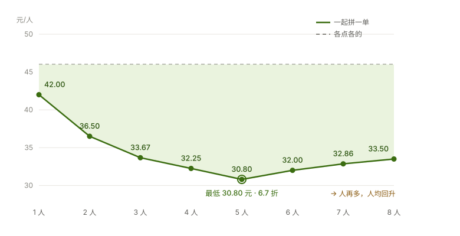

# 麦麦拼单 · mcd-pindan

> 办公室 5 个人一起点麦当劳，本来是 5 张订单、5 笔配送费，人均 **46.0 元**；
> 拼成一单之后人均 **30.8 元**，相当于 **6.7 折**。

**这个折扣不是编出来的。** 它来自三个真实存在的规则：配送费按单收取（多人分摊）、
满减券有门槛（单人小单够不着）、套餐内商品可以替换（`query-meal-detail`）。
本项目**不发明任何价格，只负责把「怎么点最便宜」算清楚**。

基于**麦当劳 MCP** 开发，需要一个 MCP Token。

---

## 效果

输入：5 人，都想点巨无霸中套餐，外送，配送费 9 元。

| 方案 | 订单数 | 餐品小计 | 配送费 | 用券 | 应付总额 | 人均实付 | 折扣 |
|---|---:|---:|---:|---|---:|---:|---:|
| 各点各的（基准） | 5 单 | 210.00 | 45.00 | 各自用券 | 230.00 | 46.00 | 原价 |
| **一起拼一单（推荐）** | 1 单 | 190.00 | 9.00 | 满190减45 | 154.00 | **30.80** | **6.7 折** |

省下来的 76 元，来自三处，每一处都可以逐项核对：

| 来源 | 省了多少 |
|---|---:|
| 配送费分摊：5 笔变 1 笔（45.00 → 9.00） | 36.00 |
| 满减券升级：从「满30减5」升到「满190减45」，净增（45.00 − 25.00） | 20.00 |
| 套餐换配置：5 人把中薯条换成小薯条（5 × 4.00） | 20.00 |
| **合计** | **76.00** |

> 基准方案也使用了它能用的券（满 42 元用「满30减5」，共减免 25 元），
> 因此这里给出的省额是**保守**估计。

人数—人均实付（同一档次餐品）：

| 人数 | 订单数 | 人均实付 | 折扣 |
|---:|---:|---:|---:|
| 1 人 | 1 单 → 1 单 | 42.00 | 9.1 折 |
| 2 人 | 2 单 → 1 单 | 36.50 | 7.9 折 |
| 3 人 | 3 单 → 1 单 | 33.67 | 7.3 折 |
| 4 人 | 4 单 → 1 单 | 32.25 | 7.0 折 |
| 5 人 | 5 单 → 1 单 | 30.80 | **6.7 折** |



图中绿色区域就是拼单相对「各点各的」省下来的部分。人数越多，省得越多，但边际递减
（优惠券的减免额有上限，人再多也不会无限便宜）。

> 完整报告见 [`examples/demo_report.md`](examples/demo_report.md)。
> 图表由 `python3 tools/make_chart.py` 根据示例数据生成，非手工绘制。

---

## 它和「拼团打折」有什么不同

| | 常见的拼团打折玩法 | 麦麦拼单 |
|---|---|---|
| 折扣从哪来 | 平台自己「发明」一个折扣 | 从真实规则里**算**出来 |
| 谁补差价 | 必须有平台补贴，否则无法成立 | 不需要任何人补贴 |
| 是否合规 | 承诺平台未授权的价格，属于误导 | 不修改任何价格，完全合规 |
| 订单归属 | 模糊 | 明确：**发起人一人下单**，其他人转账分摊 |
| 需要实时后端吗 | 需要 | **不需要**，本地即可运行 |
| 算不出来怎么办 | — | 如实告诉用户「这次拼单不划算」 |

---

## 快速开始

### 离线体验（无需 Token，评审推荐先跑这个）

```bash
python3 pindan.py --input examples/demo_input.json
```

零依赖，不需要 `pip install`，只要有 Python 3.9+。

### 接入麦当劳 MCP 实时运行

1. 到 https://open.mcd.cn/mcp 用手机号登录，在【控制台】申请 MCP Token；
2. 提供一个 Token 给程序。**不配置系统级环境变量也行**，三种方式任选：

   | 方式 | 命令 | 适用场景 |
   |---|---|---|
   | **A. 单次命令前缀**（最推荐） | `MCD_MCP_TOKEN="xxx" python3 tools/probe.py --smoke` | 不落任何文件，最安全 |
   | **B. 当前终端临时设置** | `export MCD_MCP_TOKEN="xxx"` | 只对当前终端窗口有效，关掉即失效 |
   | **C. `.env` 文件** | `cp .env.example .env`，再填入 Token | 一次配好，省得每次重敲 |

   优先级：**命令行前缀 / export &gt; `.env` 文件**。`.env` 已被 `.gitignore` 屏蔽，
   `.env.example` 里只放占位符，**切勿提交真实 Token**。

3. **先做连通性自检**（这一步能省掉后面 90% 的困惑）：

   ```bash
   python3 tools/probe.py --smoke
   ```

   它会依次检查 DNS、代理、鉴权，并直接告诉你问题出在哪。
   常见的两个坑：

   | 报错 | 原因 | 处置 |
   |---|---|---|
   | `Tunnel connection failed: 502` | 开发机设了 `HTTP_PROXY`，而 Python 的 urllib **会自动读取**它 | `export MCD_MCP_NO_PROXY=1` |
   | `[Errno 8] nodename nor servname provided` | Python 的 DNS 通道解析失败（`dig` 却能解析） | 按提示加 hosts 记录，或换网络 |

4. 核对工具入参名，并拉一遍真实数据摸清字段：

   ```bash
   python3 tools/probe.py --list
   python3 tools/probe.py --sequence --people "我:BIGMAC_SET"
   ```

5. 直接拉实时数据算方案：

   ```bash
   python3 pindan.py --live \
     --people "我:BIGMAC_SET" \
     --people "小王:MCCHICKEN_SET" \
     --delivery-fee 9
   ```

> **完整联调流程见 [`docs/CALIBRATION.md`](docs/CALIBRATION.md)**——包含字段校准方法、
> 金额复算校验、隐私脱敏说明，以及一份可直接勾选的联调检查清单。

### 在 WorkBuddy 中作为 Skill 使用

把本仓库的 [`SKILL.md`](SKILL.md) 放进 `~/.workbuddy/skills/mcd-pindan/`，
并在 WorkBuddy 里配置好 `mcd-mcp` 连接器，然后直接说：

> 我们办公室 5 个人想点麦当劳，中午送到，帮我算最便宜的方案。

### 运行测试

```bash
python3 -m unittest discover -s tests -v
```

---

## 工作原理

```
用户：5 人 × 巨无霸中套餐，外送 9 元
        │
        ├─ 1. query-meals          拉菜单与价格
        ├─ 2. query-meal-detail    查每个套餐能替换什么商品
        ├─ 3. auto-bind-coupons    先领光能领的券
        ├─ 4. query-my-coupons     我的券
        ├─ 5. query-store-coupons  门店券（容易漏的一类）
        ├─ 6. campaign-calendar    当期活动
        │
        ▼
   最优化引擎（src/mcd_pindan/optimizer.py）
        │  枚举「每人换什么配置」×「用哪张券」的全部组合
        │  目标：人均实付最低
        ▼
   上报：人均实付 / 折扣 / 省在哪 / 每人应付多少
```

引擎的求解目标是**人均实付最低**，而不是餐品小计最低：

- 因为满减券是**阶梯**的，强行压低餐品小计有时反而会掉出高门槛、损失更大的减免；
- 排序规则为「人均实付最低 → 用上的券更优 → 餐品小计更低」；
- 组合数量上限 12 万，超出时按人数自动收缩候选配置，保证秒级返回。

计算示例（5 人巨无霸套餐）：

| 步骤 | 计算 |
|---|---|
| 餐品小计 | 5 × 42 = 210 |
| 换配置后 | 5 × (42 − 4) = 190 ← 换来薯条 |
| 命中券 | 190 ≥ 190，用「满190减45」 |
| 加上配送费 | 190 + 9 − 45 = 154 |
| 人均 | 154 ÷ 5 = **30.80** |

---

## 目标用户

| 用户 | 场景 |
|---|---|
| **办公室同事 / 行政** | 中午一起点外送、下午茶，需要有人下单、大家 AA |
| **学生宿舍 / 拼房室友** | 晚上一起点，凑满减、摊配送费 |
| **任何多人一起点外卖的人** | 想知道「到底怎么点最便宜」 |
| **麦门玩家** | 想吃到熟悉的口味，同时不想多花冤枉钱 |

---

## 用到的麦当劳 MCP 能力

完整说明见 [`MCP_INTEGRATION.md`](MCP_INTEGRATION.md)。

核心使用的能力：`query-meals`、`query-meal-detail`（套餐替换）、`query-my-coupons`、
`query-store-coupons`、`auto-bind-coupons`、`campaign-calendar`、`calculate-price`、`create-order`。

---

## 目录结构

```
mcd-pindan/
├── SKILL.md                       WorkBuddy Skill 定义（对话式使用入口）
├── README.md                      本文件
├── CONTEST_DECLARATION.md         参赛声明（官方模板，内容未改动）
├── MCP_INTEGRATION.md             麦当劳 MCP 接入说明
├── mcp-config.example.json        脱敏 MCP 配置示例（仅环境变量占位符）
├── workbuddy.md                   WorkBuddy 对话上下文
├── pindan.py                      零依赖启动器
├── .env.example                   本地配置模板（复制成 .env 后填 Token）
├── src/mcd_pindan/
│   ├── optimizer.py               ★ 凑单最优化引擎（核心算法）
│   ├── mcp_client.py              麦当劳 MCP 客户端 + 响应适配层
│   └── cli.py                     命令行入口
├── tools/
│   ├── probe.py                   ★ MCP 联调探测器（连通性自检 + 字段报告）
│   └── make_chart.py              生成 README 折线图
├── docs/
│   ├── curve.svg                  README 引用的图表
│   └── CALIBRATION.md             真实 MCP 联调手册
├── examples/
│   ├── demo_input.json            离线示例输入
│   └── demo_report.md             示例输出报告
└── tests/test_optimizer.py        10 项单元测试
```

---

## 常见问题

**Q：为什么不做成「人越多折扣越大」的实时拼单系统？**

因为做不到，而且不应该做。三个原因：① MCP Token 是个人身份，无法代他人下单，
订单只能归属下单账号；② `calculate-price` 返回的是服务端价格，没有任何接口能施加
自定义折扣，折扣必须有补贴方才成立；③ 承诺平台未授权的价格属于误导，会直接违反活动规则。

**Q：那「人越多越便宜」是真的吗？**

是真的，但机制是**减少订单数**而不是打折：n 个人原本要下 n 单、付 n 笔配送费，
拼成一单后只付 1 笔。所以人均下降是有限度的——如果新加入的人点得特别多，
人均也可能反而上升。本项目的报告会如实展示这一点。

**Q：用哪张券是算出来的还是随便挑的？**

算出来的。引擎枚举所有满足门槛的券，取减免额最大的那张，并校验是否存在
「压低餐品小计反而更亏」的陷阱。

**Q：会上传我的 Token 或地址吗？**

不会。Token 只从环境变量 `MCD_MCP_TOKEN` 读取，不写入任何文件、不出现在输出中。
抓取到的实时数据默认不落盘，`.gitignore` 已屏蔽 `data/live/`。

**Q：金额和实际结算不一致怎么办？**

以麦当劳结算页为准。本项目所有金额均来自 MCP 返回或由其直接计算，
不含任何估算或假设的价格。

---

## 参赛信息

本项目为**麦当劳程序员创意开发大赛**参赛作品，使用 WorkBuddy 开发。

- 项目名称：麦麦拼单（mcd-pindan）
- 使用麦当劳 MCP：`https://mcp.mcd.cn`
- 本项目由参赛者独立开发，**非麦当劳官方产品**；输出仅供参考，
  餐品信息、价格及供应状态以麦当劳官方渠道的实时结果为准。
